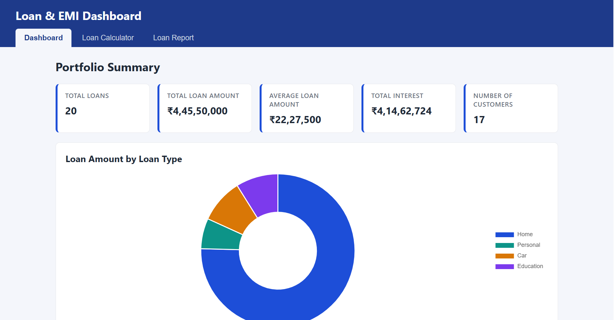
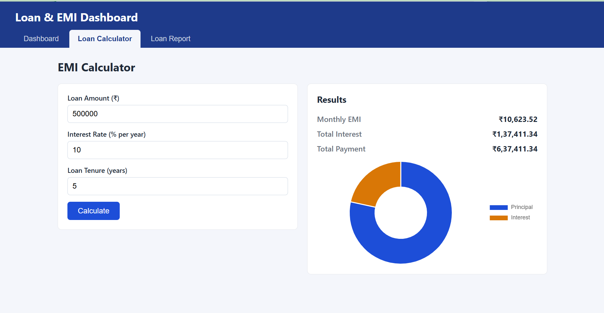
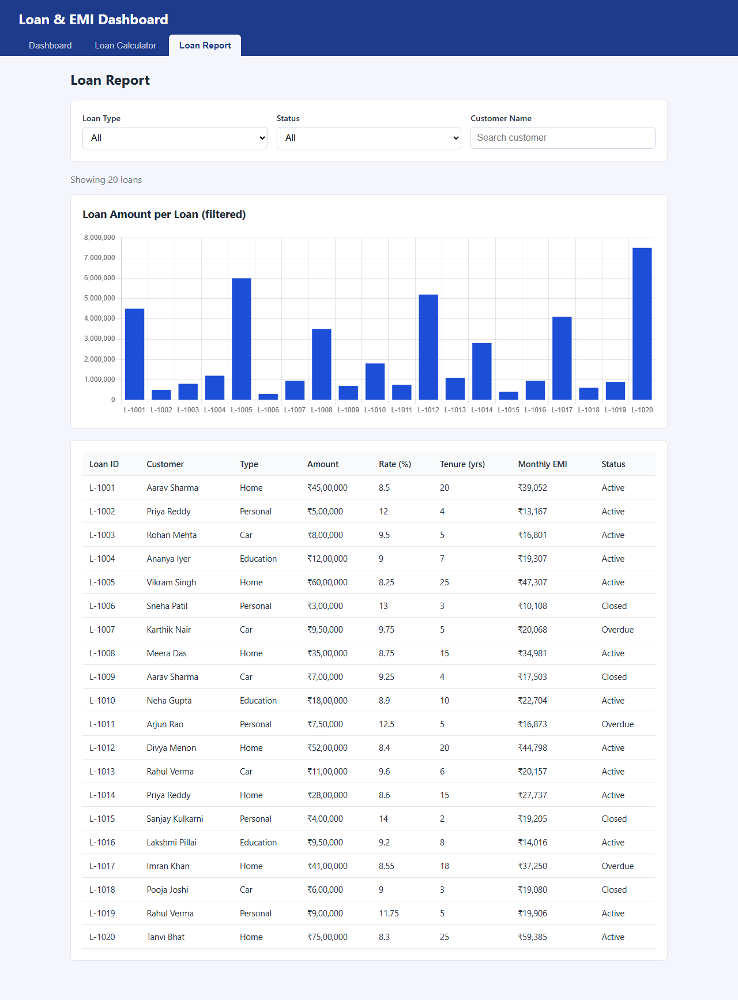
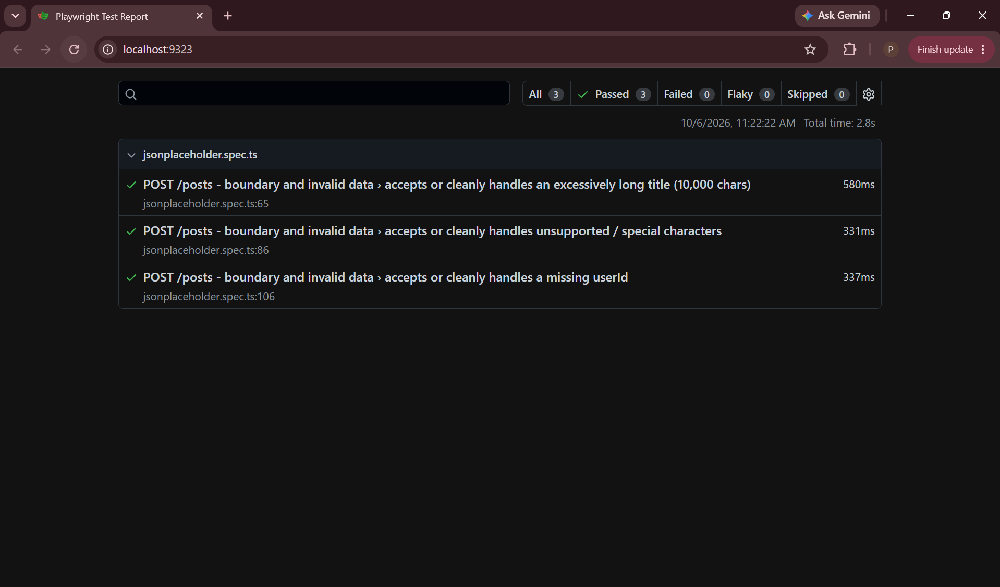
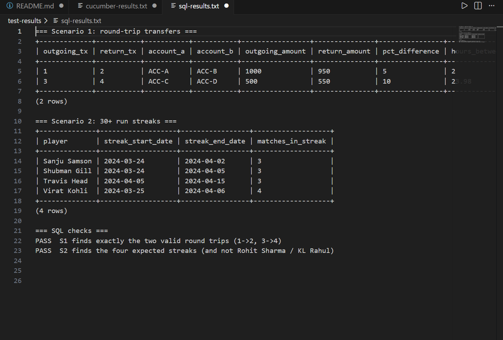
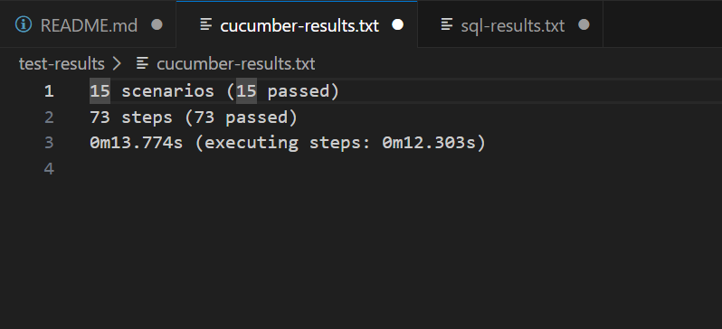

# Streamhub – Section A: Loan/EMI Dashboard + UI, API and SQL Automation

## 1. Overview

This repository contains my submission for the **Streamhub LTD Fullstack + QA Automation Assessment – Section A**.

The submission includes:

- A Loan/EMI Dashboard web application
- Playwright + Cucumber UI automation using TypeScript
- Page Object Model (POM)
- Independent EMI calculation validation
- JSONPlaceholder API boundary/invalid-input tests
- SQL scenarios for round-trip transfers and IPL 2024 batting streaks
- AI self-healing locator design and proof-of-concept documentation
- Test reports, console results, and screenshots

---

## 2. Section Chosen

I selected **Section A – Fullstack + QA Automation**.

| Assessment Area | Implementation |
|---|---|
| A1 Web application | `app/`, `server.js` |
| A2 Playwright + Cucumber UI tests | `tests/` |
| A3 API tests | `api-tests/jsonplaceholder.spec.ts` |
| A4 SQL scenarios | `sql/` |
| AI self-healing | `SELF_HEALING.md`, `tests/self-healing/` |

---

## 3. Application Features

### Dashboard

The dashboard displays:

- Total number of loans
- Total loan amount
- Average loan amount
- Total interest
- Number of customers
- Doughnut chart showing loan amount by loan type

### Loan Calculator

The calculator accepts:

- Loan amount
- Interest rate
- Loan tenure

It calculates:

- Monthly EMI
- Total interest
- Total payment
- Principal/interest chart

Invalid input is also handled with an appropriate validation message.

### Loan Report

The report contains:

- 20 mock loan records
- Loan type filter
- Status filter
- Customer name search
- Loan amount bar chart
- Loan details table

Application data is stored in:

`app/data/loans.json`

The application does not require a database or backend API for its dashboard data.

---

## 4. Application Screenshots

### Dashboard



### Loan Calculator



### Loan Report



---

## 5. Technology Stack

- HTML
- CSS
- Vanilla JavaScript
- Chart.js
- Node.js static server
- TypeScript
- Playwright `1.56.1`
- Cucumber.js
- dotenv
- sql.js / SQLite
- Chromium

---

## 6. Automation Architecture

The UI automation follows a layered Playwright + Cucumber architecture:

```text
Cucumber Feature Files
        |
        v
Step Definitions
        |
        v
Page Objects
        |
        v
Playwright
        |
        v
Loan/EMI Web Application
```

The framework uses:

- Feature files for readable scenarios
- Step definitions for Cucumber glue
- Page Objects for locators and UI actions
- Shared test configuration
- Environment variables for URLs
- An independent EMI formula for expected-value validation

The EMI expected value is calculated independently from the application implementation in:

`tests/support/emi.ts`

This prevents the UI test from simply trusting the application's own calculation.

---

## 7. Project Structure

```text
streamhub-section-a/
│
├── app/
│   ├── data/
│   │   └── loans.json
│   ├── index.html
│   ├── script.js
│   └── styles.css
│
├── api-tests/
│   └── jsonplaceholder.spec.ts
│
├── scripts/
│
├── sql/
│   ├── schema.sql
│   ├── sample_data.sql
│   ├── scenario1_round_trip.sql
│   ├── scenario2_ipl_streak.sql
│   └── screenshots/
│
├── tests/
│   ├── features/
│   ├── steps/
│   ├── pages/
│   ├── support/
│   └── self-healing/
│
├── test-results/
│   ├── reports/
│   ├── screenshots/
│   ├── cucumber-results.txt
│   └── sql-results.txt
│
├── .env.example
├── .gitignore
├── cucumber.js
├── package.json
├── package-lock.json
├── playwright.config.ts
├── playwright.selfhealing.config.ts
├── README.md
├── SELF_HEALING.md
├── server.js
└── tsconfig.json
```

---

## 8. Environment Configuration

The application and tests use environment variables rather than hardcoding the application URL inside the tests.

Example `.env`:

```env
HOST=127.0.0.1
PORT=3000
BASE_URL=http://127.0.0.1:3000
API_BASE_URL=https://jsonplaceholder.typicode.com
HEADLESS=true
SLOW_MO=0
```

A template is provided in:

`.env.example`

Do not commit secrets or private credentials to the repository.

---

## 9. Installation

### Prerequisites

- Node.js
- npm
- Git

### Install dependencies

```bash
npm install
```

### Install Playwright Chromium

```bash
npx playwright install chromium
```

---

## 10. Running the Application

Start the Loan/EMI application:

```bash
npm run app
```

The application runs using the configured `BASE_URL`.

Default:

```text
http://127.0.0.1:3000
```

---

# 11. A2 – Playwright + Cucumber UI Automation

The UI automation covers the main user journeys and independent calculation validation.

The test suite verifies:

### Dashboard

- Dashboard navigation
- Summary cards
- Loan type chart visibility
- Non-zero chart data

### Loan Calculator

- Calculator navigation
- Valid EMI calculation
- Independent expected EMI validation
- Total interest validation
- Total payment validation
- Principal/interest chart visibility
- Invalid input handling

### Loan Report

- Report navigation
- Loan table visibility
- Loan record count
- Filters
- Report chart visibility
- Non-zero chart data

Run the UI suite:

```bash
npm run test:ui
```

The UI suite uses:

- Cucumber feature files
- Step definitions
- Page Objects
- Playwright
- Environment-based configuration

---

## 12. A3 – API Boundary / Invalid Data Tests

API tests are implemented using Playwright against JSONPlaceholder.

The following boundary/invalid-input cases are covered:

1. **10,000-character title**
2. **Special/unsupported characters**
3. **Missing `userId`**

The tests verify that the request completes without an unexpected server-side failure and that the response remains well formed.

JSONPlaceholder is a mock API and does not necessarily reject invalid payloads with `400` or `422`. Therefore, the tests do not incorrectly assume real validation behavior from the mock service.

Run the API tests:

```bash
npm run test:api
```

Generate/open the API HTML report:

```bash
npm run report:api
```

### API Test Report



---

# 13. A4 – SQL Scenarios

SQL execution is implemented using `sql.js` / SQLite.

## Scenario 1 – Round-trip Transfers

The query identifies transfers where:

- The money is transferred from one account to another
- A return transfer occurs
- The returned amount is within **10%** of the outgoing amount
- The return occurs within **24 hours**

The final sample data produces the expected valid round trips.

## Scenario 2 – IPL 2024 Batting Streak

The query identifies players who scored **30 or more runs in at least 3 consecutive matches**.

The output returns:

- Player name
- Streak start date
- Streak length

The final test output identifies the expected qualifying streaks.

Run both SQL checks:

```bash
npm run test:sql
```

### SQL Results



The SQL console output is also preserved in:

`test-results/sql-results.txt`

---

# 14. Test Results

The final local test run produced the following results:

| Suite | Result |
|---|---|
| Type-check | Passed |
| UI – Cucumber | **15 scenarios, 73 steps – all passed** |
| API – Playwright | **3 tests – all passed** |
| SQL | **2 of 2 checks passed** |
| Self-healing demo | **5 intentionally broken locators fail by design** |

### Cucumber Test Results

```text
15 scenarios (15 passed)
73 steps (73 passed)
```



The console output is also available at:

`test-results/cucumber-results.txt`

### API Test Results

```text
3 passed
0 failed
0 flaky
0 skipped
```

The HTML report is available at:

`test-results/reports/api-html/`

### SQL Test Results

Both SQL checks passed:

- Scenario 1: valid round-trip transfers
- Scenario 2: IPL 2024 qualifying batting streaks

The console output is available at:

`test-results/sql-results.txt`

---

# 15. AI Self-Healing Locator Design

The self-healing exercise is documented in:

`SELF_HEALING.md`

The demo intentionally contains **5 incorrect/brittle locators** that are left broken.

Examples include:

- Incorrect `data-testid`
- Incorrect accessible label
- Brittle CSS structure
- Incorrect role
- Incorrect text

The self-healing design explains how an AI-assisted system could:

1. Detect a locator-not-found failure
2. Capture the failing locator and test context
3. Capture relevant DOM/accessibility information
4. Ask an AI model for candidate replacement locators
5. Validate the candidates
6. Prefer semantic and resilient locators
7. Re-run the affected behavior
8. Prevent blind/hallucinated locator replacement
9. Record the change for human review

The design intentionally avoids automatically changing locators merely because an assertion failed.

The self-healing demonstration is not presented as a production AI service; it is a documented design/POC approach.

---

# 16. Locator Strategy

The real test suite prefers resilient Playwright locators such as:

```text
getByRole()
getByLabel()
getByText()
getByTestId()
```

The framework avoids unnecessary:

- `nth-child()`
- Long XPath expressions
- Generated CSS class selectors
- Position-dependent selectors

The goal is to keep tests maintainable when the UI structure changes.

---

# 17. Test Evidence

The repository contains test evidence under:

```text
test-results/
├── reports/
├── screenshots/
├── cucumber-results.txt
└── sql-results.txt
```

Screenshots:

```text
test-results/screenshots/
├── Dashboard.png
├── LoanCalculator.png
├── LoanReport.png
├── CucumberResults.png
├── PlaywrightAPIReport.png
└── SQLResults.png
```

---

# 18. Running the Complete Test Suite

Run all major suites with:

```bash
npm test
```

This runs:

```text
UI / Cucumber
      +
API / Playwright
      +
SQL
```

Individual commands are also available:

```bash
npm run test:ui
npm run test:api
npm run test:sql
```

---

# 19. AI / Claude Code Usage and Reflection

AI tools, including Claude Code, were used during development to help:

- Scaffold the automation framework
- Create initial project/configuration structure
- Generate and refine Page Objects
- Create Cucumber feature files and step definitions
- Debug Playwright/Cucumber issues
- Develop SQL scenarios
- Review locator strategies
- Improve README/documentation

The generated output was not accepted blindly.

Human verification was used to catch and correct issues such as:

- Incorrect Playwright/Cucumber assumptions
- Locator mismatches
- Test-data problems
- API/proxy-related false assumptions
- SQL/query edge cases
- Version/API differences

The EMI calculation and SQL outputs were independently checked rather than relying only on AI-generated expectations.

---

# 20. Known Limitations

- The dashboard uses mock loan data from `app/data/loans.json`; it is not connected to a production database.
- The API tests depend on network access to JSONPlaceholder.
- JSONPlaceholder is a mock service, so invalid payloads may still return HTTP 201.
- SQL is executed with SQLite/sql.js; SQL syntax may differ from other database engines.
- The round-trip tolerance is measured against the outgoing transfer amount.
- For the IPL query, "consecutive matches" refers to consecutive matches represented in the supplied batting data.
- UI chart tests validate chart presence/data rather than performing pixel-level visual comparison.
- Chromium is the configured browser for the automation run.
- SQL result evidence is also preserved as console text in addition to the screenshot.

---

# 21. Submission Checklist

| Requirement | Status |
|---|---|
| Section A application | Completed |
| Dashboard/landing summary | Completed |
| User-input EMI calculator | Completed |
| Chart/visualization | Completed |
| Playwright + Cucumber framework | Completed |
| Page Object Model | Completed |
| Environment-based URL | Completed |
| Independent EMI validation | Completed |
| API boundary/invalid-input tests | Completed |
| SQL Scenario 1 | Completed |
| SQL Scenario 2 | Completed |
| AI self-healing documentation | Completed |
| Intentionally broken locators | Completed |
| Test execution evidence | Included |
| Screenshots | Included |
| README setup/documentation | Included |

---

## 22. Final Result

The final local execution is green for the required Section A automation:

```text
UI:   15 scenarios passed / 73 steps passed
API:  3 tests passed
SQL:  2 checks passed
```

The self-healing demo intentionally contains broken locators to demonstrate how AI-assisted locator recovery would detect, propose, validate, and safely review locator replacements.
